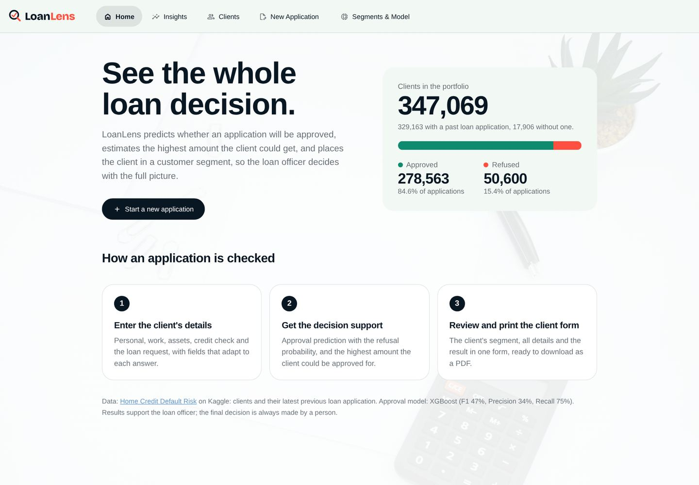
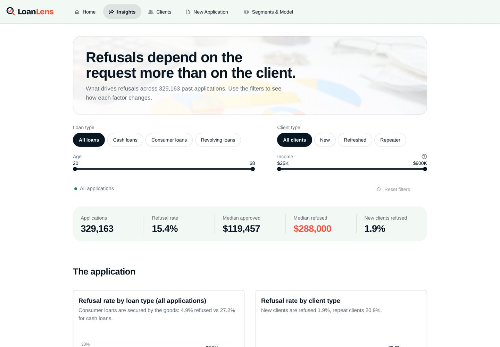
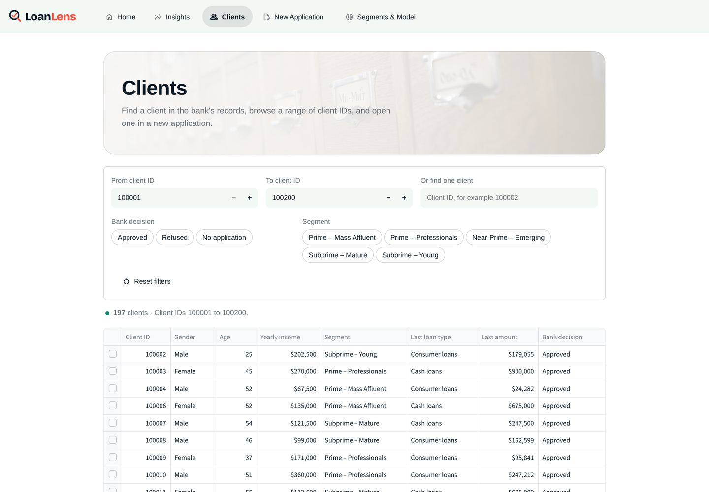
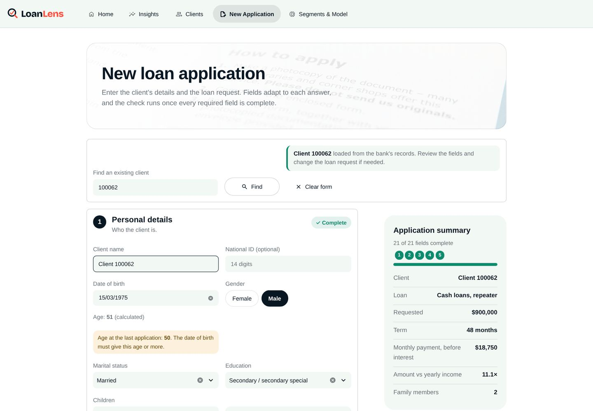
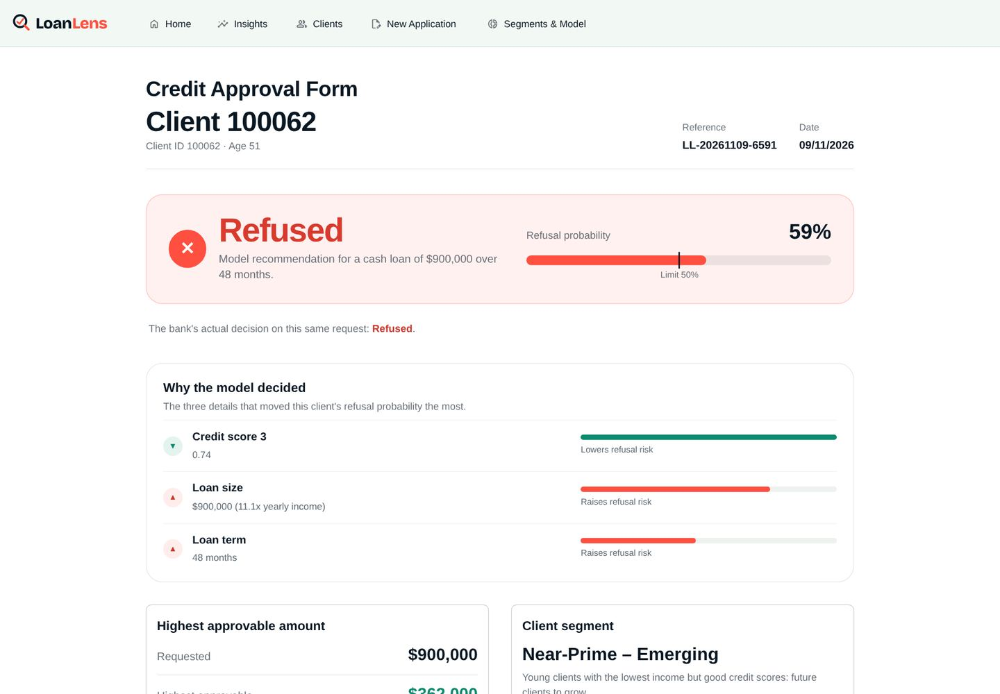

<p align="center">
  
</p>

<p align="center">
  <b>See the whole loan decision.</b><br>
  A decision-support app for loan officers: approval prediction, the highest approvable amount,
  the reasons behind each result, and the client's segment, in one printable form.
</p>

<p align="center">
  <a href="https://clientloanlens.streamlit.app/">Live app</a> ·
  <a href="https://www.kaggle.com/competitions/home-credit-default-risk">Data source</a> ·
  <a href="#notebooks">Notebooks</a>
</p>



## The problem

A loan officer has to decide on every application, but the bank's past decisions hold patterns no
single officer can see. **LoanLens** learns from 329,163 past decisions and gives the officer a second
opinion: how likely the application is to be refused, why, and what the client could be approved for.
The officer always makes the final decision.

## What the app does

| Page | What it shows |
|---|---|
| **Home** | The portfolio at a glance and how an application is checked. |
| **Insights** | Interactive EDA: refusal rates by loan type, client type, amount, term, age, credit score, education and income type, with filters. |
| **Clients** | Browse the bank's records by client ID range, bank decision and segment; open any client in a new application. |
| **New Application** | A five-section form with dependent fields, live validation and a progress summary. Can be filled from an existing client. |
| **Credit Approval Form** | The model's recommendation, refusal probability, top 3 reasons, highest approvable amount, client segment, officer decision, and a one-page PDF download. |
| **Segments & Model** | The five customer segments and how the approval model was built and how to read it. |

<table>
  <tr>
    <td></td>
    <td></td>
  </tr>
  <tr>
    <td></td>
    <td></td>
  </tr>
</table>

## Data

[Home Credit Default Risk](https://www.kaggle.com/competitions/home-credit-default-risk) (Kaggle):
`application_train`, `application_test` and `previous_application`.

- Each client is joined with their **latest** previous application (Approved / Refused).
- After cleaning: **347,069 clients × 38 columns**; 329,163 of them have a past decision.
- The target is imbalanced: **84.6% Approved, 15.4% Refused**.
- Columns set by the bank with the decision (`AMT_CREDIT`, `AMT_ANNUITY`) were removed to avoid leakage.

## Models

### Approval model (classification)

- **New features:** loan to income, down payment ratio, payment to income.
- **Preprocessing pipeline:** median imputation, log + RobustScaler for money columns, OneHot, Ordinal
  and Binary encoding.
- **Five algorithms** compared with class weights for the imbalance, then **GridSearchCV** (5-fold) on
  Logistic Regression and XGBoost, chosen by F1.

| Model (5-fold CV) | F1 | Precision | Recall |
|---|---|---|---|
| **XGBoost (tuned, final)** | **47.0%** | **34.2%** | **74.9%** |
| Logistic Regression | 44.6% | 31.4% | 77.2% |
| Random Forest | 43.8% | 47.3% | 40.9% |
| Naive Bayes | 36.4% | 23.0% | 87.8% |
| Decision Tree | 31.4% | 31.5% | 31.3% |

The model catches about 3 of every 4 refused applications. Loan type alone carries 68% of its
importance: what the client asks for matters more than who the client is.

In the app, the model also gives:
- **Why the model decided:** the 3 details that moved this client's refusal probability the most
  (XGBoost feature contributions).
- **Highest approvable amount:** the largest amount, at or below the request, that the model would approve.

### Customer segments (clustering)

**KMeans (k = 5)** on income per person, age, region rating, credit score, car ownership and education,
with k picked by the elbow method and silhouette score:
Prime – Mass Affluent, Prime – Professionals, Near-Prime – Emerging, Subprime – Mature, Subprime – Young.

## Notebooks

| Notebook | Content |
|---|---|
| `LoanLens_01_Data_Cleaning.ipynb` | Joining the tables, cleaning, and EDA with business questions. |
| `LoanLens_02_Approval_Model.ipynb` | Features, preprocessing pipeline, model comparison, tuning, final model. |
| `LoanLens_03_Segmentation.ipynb` | Clustering features, elbow and silhouette, KMeans segments and profiles. |

## Project structure

```
├── app.py                      # Streamlit entry point and navigation
├── views/                      # One file per page
├── core/
│   ├── data.py                 # Cached data loading and statistics
│   ├── model_service.py        # Prediction, reasons, highest approvable amount, segment
│   ├── form_rules.py           # Form options and validation rules
│   ├── report.py               # Credit Approval Form as PDF
│   ├── charts.py, theme.py     # Plotly helpers and the design system
│   └── model_card.py           # Results copied from the notebooks
├── assets/                     # Logo, page images, screenshots
├── *.pkl                       # Trained pipelines (XGBoost, KMeans) and their inputs
├── Clients_LoanLens_clean.parquet
└── LoanLens_0*.ipynb
```

## Run it locally

Requires **Python 3.11** (the version the models were trained with).

```bash
git clone <this repo>
cd <repo folder>
pip install -r requirements.txt
streamlit run app.py
```

The app needs only the files in this repository. To re-run notebook 01, download the three CSV files
from Kaggle into the project folder (they are not in the repository because of their size).

## Built with

Python · pandas · scikit-learn · XGBoost · category_encoders · Plotly · Streamlit · fpdf2

---

Final project for the CDSP Machine Learning diploma. The data is public competition data; client names
and national IDs in the app are entered by the user and are not part of the data.
